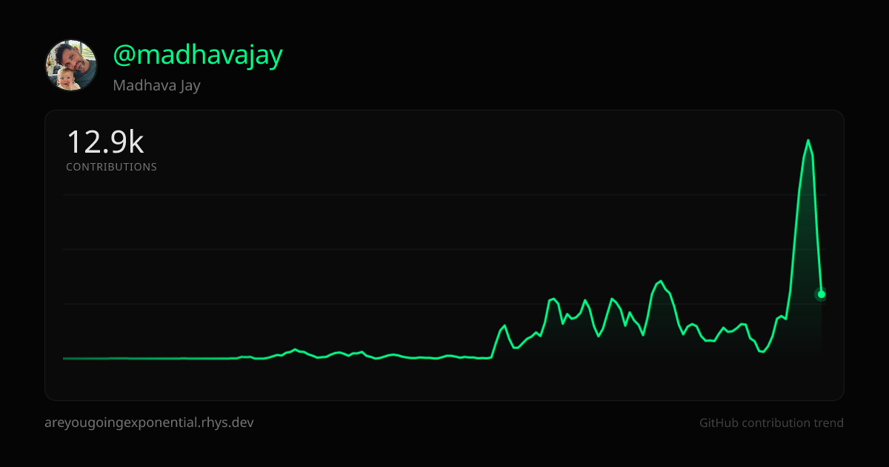

<h1 align="center">Madhava Jay</h1>

  Principal Engineer @ <a href="https://github.com/OpenMined">OpenMined</a> 
  Building privacy-preserving AI, bioinformatics systems, and agentic developer tools.

  <a href="https://madhavajay.com">Blog</a> •
  <a href="https://pypi.org/user/madhavajay/">PyPI</a> •
  <a href="https://crates.io/users/madhavajay">crates.io</a> •
  <a href="https://www.linkedin.com/in/madhavajay/">LinkedIn</a> •
  <a href="https://twitter.com/madhavajay">X</a> •
  <a href="https://committers.top/australia">committers.top AU</a>

## What I work on

I like difficult problems at the edge of AI, privacy, developer tooling, and biology. Most of my recent work sits somewhere between secure computation, distributed infrastructure, agentic workflows, and practical open source shipping.

- Privacy-preserving AI and secure data infrastructure at OpenMined
- Bioinformatics tooling and workflow systems
- Agentic notebook and coding interfaces
- Open source compiler, SDK, and systems experiments in Python and Rust
- Mobile / Wearable stuff

  <a href="https://areyougoingexponential.rhys.dev/madhavajay">areyougoingexponential.rhys.dev/madhavajay</a>

  

## Featured Repositories

Sorted loosely by public traction, then recency and how representative they are of the work.

| Repo | Stars | Lang | Why it matters |
| --- | ---: | --- | --- |
| [OpenMined/PySyft](https://github.com/OpenMined/PySyft) | 9869 | Python | Flagship privacy-preserving data science platform at OpenMined |
| [OpenMined/syftbox](https://github.com/OpenMined/syftbox) | 19 | Go / Rust | "The internet of private data" |
| [OpenMined/biovault](https://github.com/OpenMined/biovault) | 10 | Rust | Private bioinformatics infrastructure |
| [madhavajay/cleon](https://github.com/madhavajay/cleon) | 2 | Python | Use Agent harnesses in Jupyter notebooks |
| [madhavajay/crabmux](https://github.com/madhavajay/crabmux) | 2 | Rust | Better Tmux launcher |
| [madhavajay/RememberIt](https://github.com/madhavajay/RememberIt) | 2 | Jupyter Notebook | Flashcard / memory tooling experiments |
| [madhavajay/tinyviz](https://github.com/madhavajay/tinyviz) | 2 | Jupyter Notebook | tinygrad tensor op visualizer |
| [madhavajay/ud953](https://github.com/madhavajay/ud953) | 2 | Python | Udacity linear algebra refresher work |
| [OpenMined/biovault-desktop](https://github.com/OpenMined/biovault-desktop) | 1 | Jupyter Notebook | Desktop-facing Biovault work |
| [madhavajay/markyd](https://github.com/madhavajay/markyd) | 0 | Swift | Clipboard URL to Markdown utility |
| [madhavajay/ralph](https://github.com/madhavajay/ralph) | 13 | Rust | Rust systems work and tooling |
| [madhavajay/blog](https://github.com/madhavajay/blog) | 0 | HTML | Source for my writing |

## Package Work

The most active public package profile is on PyPI:

- [madhavajay on PyPI](https://pypi.org/user/madhavajay/)
- Recent packages: [biovault-beaver](https://pypi.org/project/biovault-beaver/), [syftbox-sdk](https://pypi.org/project/syftbox-sdk/), [syftbox-crypto-python](https://pypi.org/project/syftbox-crypto-python/), [bioscript](https://pypi.org/project/bioscript/), [cleon](https://pypi.org/project/cleon/), [rememberit](https://pypi.org/project/rememberit/), [tinyviz](https://pypi.org/project/tinyviz/)

## Publications

- [Syft 0.5: A Platform for Universally Deployable Structured Transparency](https://dp-ml.github.io/2021-workshop-ICLR/files/35.pdf)  
  2021 workshop paper.
- [BioVault: A privacy-first data visitation platform for equitable global collaboration in biomedicine](https://www.biorxiv.org/content/10.64898/2026.02.12.705603v1)  
  2026 bioRxiv preprint.

## Talks

- [India AI Impact Summit 2026: Genomics and AI for Global Health](https://www.youtube.com/watch?v=BJ4LK9Knemk)
- [2021 PETs: Remote Data Science Unleashed - R Gov NY'21](https://www.youtube.com/watch?v=qVf0tPBzr2k)
- [Open Source is your Destiny \| Madhava Jay \| SFD-PU'21 (2021)](https://www.youtube.com/watch?v=ghvE6Y1oIrs&t=1s)
- [Giving Back with GitHub Munich iOS Meetup (2016)](https://www.youtube.com/watch?v=ErG-8-TMXug)

## Writing

Recent posts from the blog repo:

- [Agentic Coding Slot Machines](https://madhavajay.com/agentic-coding-slot-machines/)
- [Cold Start Review](https://madhavajay.com/cold-start-review/)
- [Staying Relevant in an Agentic World](https://madhavajay.com/staying-relevant-in-an-agentic-world/)
- [LLM Glove](https://madhavajay.com/llm-glove/)

You can also browse the source for the writing here:

- [madhavajay/blog](https://github.com/madhavajay/blog)

## Elsewhere

- [GitHub](https://github.com/madhavajay)
- [Website](https://madhavajay.com)
- [Blog source](https://github.com/madhavajay/blog)
- [PyPI](https://pypi.org/user/madhavajay/)
- [LinkedIn](https://www.linkedin.com/in/madhavajay/)
- [X / Twitter](https://twitter.com/madhavajay)
